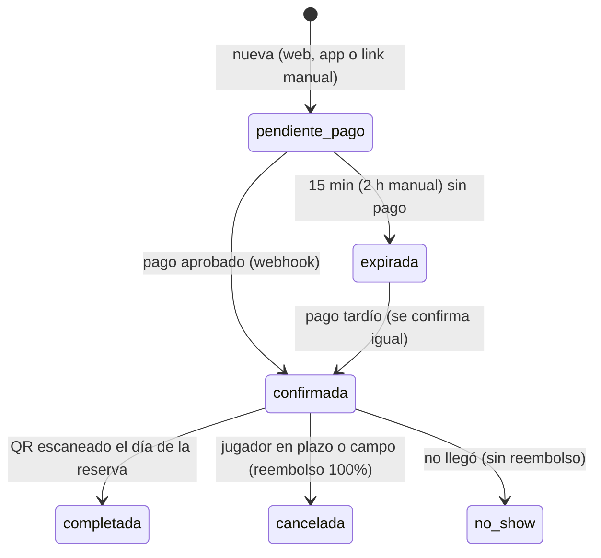

# ARENA MVP — Reservas para campos

Especificación v1 · 21 oct 2026 · Fuente de verdad para Grokbot.
Esquema de BD: `supabase/sql/arena_mvp.sql` (ya corrido en Supabase; no se modifica).

## 1. Resumen

El MVP de ARENA hace una sola cosa: que un campo reciba y gestione reservas en línea, cobradas 100% por AirNation. El campo publica su catálogo (paquetes, derechos de campo, rentas) y abre los días que ya marca su horario; el jugador reserva con o sin cuenta y paga en línea; el dueño administra su agenda desde AirNation. Se construye encima de lo que ya existe: tabla `fields` (con `horarios_json`), `/admin/campos`, `/mi-campo/[id]`, backend Express, Resend, push y Cloudflare Images.

**Entra en el MVP**

- Admin AirNation activa ARENA en un campo ya cargado desde `/admin/campos` y lo liga a una cuenta de AirNation (dueño).
- Catálogo por campo con fotos: paquetes, derechos de campo, rentas y extras.
- Sin turnos ni cupo: se reserva cualquier día en que el campo abre según su horario actual (`fields.horarios_json`). El campo solo marca días cerrados extra (lluvia, evento privado).
- Reserva pública con cuenta o como invitado, pagada 100% en línea y confirmada al instante en cuanto se aprueba el pago.
- El dinero entra a AirNation: se retiene la comisión y el resto se liquida al campo cada semana. El campo ve sus saldos.
- Reembolsos automáticos por la pasarela cuando cancela el jugador en plazo o cancela el campo.
- QR único por reserva: el jugador lo muestra en la entrada y el campo lo escanea para registrar la llegada.
- Panel del dueño: agenda por día, escáner de QR, cancelar, marcar no-show, saldos y reserva manual por link de pago (para las que llegan por WhatsApp).
- Pasarela agnóstica con proveedor `mock` mientras se decide el real.
- Email y push al dueño y al jugador.

**No entra:** pago en campo, POS, inventario, staff múltiple con permisos, productores de eventos y venta de boletos, liberación progresiva de fondos, campos privados nuevos, QR por jugador, recordatorio 24 h, renta por horas, proveedor de pago real.

## 2. Decisiones cerradas (21 oct 2026)

1. **Disponibilidad:** sin turnos ni cupo. El jugador elige un día en que el campo abre y cuántos jugadores van; no hay límite de lugares y el campo no configura nada nuevo.
2. **Confirmación:** siempre automática al aprobarse el pago. El campo solo recibe el aviso; no existe aprobar ni rechazar.
3. **QR:** uno por reserva, no por jugador. Lo muestra quien reservó; el campo lo escanea una sola vez y registra cuántos llegaron.
4. **Cobro:** 100% en línea. No existe pago en campo. Todo el dinero pasa por AirNation.
5. **Comisión:** el jugador solo paga el precio final publicado. AirNation retiene su % (8 / 3 / 1.5 según plan, guardado en `arena_field_settings.comision_pct`) y absorbe el costo de la pasarela. Ningún cargo extra visible al jugador.
6. **Liquidación al campo:** semanal, cada lunes, por las reservas pagadas cuya fecha ya pasó, por transferencia a la CLABE del campo.
7. **Reembolsos:** si el jugador cancela antes del límite recibe 100%; después, 0%. Si cancela el campo, 100% siempre. El límite es `cancelacion_horas_limite` (default 24 h) contado hacia atrás desde la hora de apertura del día reservado. Ejemplo: abre sábado 9:00 → cancelación con reembolso hasta viernes 9:00.
8. **Plan del campo:** en el MVP todos los planes reservan; el plan solo define el % de comisión.
9. **Proveedor de pago:** pendiente. Se construye con `mock`. No se abre a un campo real hasta conectar el proveedor y tener TyC + Aviso de Privacidad ARENA.

## 3. Flujos

### 3.1 Admin AirNation — `/admin/arena`

1. Crea el campo como hoy, manual, en `/admin/campos/nuevo` (incluye su horario semanal).
2. En `/admin/arena` elige el campo y lo activa: plan (free/premium/pro) y % de comisión.
3. Liga el campo a una cuenta de AirNation: busca al usuario por alias, nombre o email (reusa `GET /api/v1/users/search`) y lo asigna como `owner`. Un campo puede tener más de un miembro.
4. Puede cargar catálogo, fotos y días cerrados en nombre del campo.
5. Ve reservas y pagos de todos los campos, el saldo por liquidar de cada uno y registra cada liquidación (transferencia). Puede pausar ARENA en un campo.

### 3.2 Dueño del campo — `/mi-campo/[id]/arena`

1. Entra con su cuenta; la pestaña ARENA solo aparece si es miembro activo del campo y ARENA está activo.
2. **Catálogo:** alta y edición de paquetes, derechos de campo, rentas y extras: nombre, descripción, qué incluye, precio, unidad de cobro, hasta 6 fotos, activo/inactivo, orden.
3. **Horario y días cerrados:** usa el mismo horario semanal de la ficha del campo (qué días abre y de qué hora a qué hora). Aparte marca fechas cerradas.
4. **Agenda:** reservas pagadas por día con jugadores esperados y llegados. No confirma nada: cada reserva le llega ya pagada y confirmada como aviso. Acciones: cancelar (reembolso 100% automático) y marcar no-show.
5. **Escáner QR:** abre la cámara, lee el QR y muestra nombre, fecha, jugadores y lo pagado; un toque registra la llegada (con ajuste de cuántos llegaron). Respaldo: teclear el código `AR-XXXXXX`.
6. **Reserva manual por link de pago:** para las que llegan por WhatsApp. Captura día, jugadores, conceptos y contacto; el sistema genera un link de pago que vence en 2 horas, se envía por email y se puede copiar a WhatsApp.
7. **Saldos:** vendido, comisión AirNation, reembolsado, por liquidar y liquidado, con el detalle de cada liquidación.
8. **Configuración:** política de cancelación (texto + horas límite), anticipación mínima y máxima, email y teléfono de avisos, y datos para liquidación (banco, CLABE, titular).

### 3.3 Jugador o invitado — `/campos/[slug]/reservar`

1. En la ficha `/campos/[slug]` aparece el botón RESERVAR si el campo tiene ARENA activo.
2. Elige el día (calendario solo con días en que el campo abre y sin bloqueo) y cuántos jugadores van.
3. Elige un concepto base obligatorio (paquete o derecho de campo) y, opcional, rentas y extras. Ve el total calculado por el servidor.
4. Datos de contacto: con sesión se precargan; sin sesión captura nombre, email y teléfono (modo invitado). Acepta la política de cancelación y reembolso del campo.
5. Paga en línea (obligatorio), con 15 minutos para completar el pago.
6. Pago aprobado → reserva confirmada al instante. Llega a `/reservas/[codigo]?t=<access_token>` con el QR grande, código, detalle, recibo, mapa, política y botón de cancelar si sigue en plazo. El mismo QR va en el email.
7. Pago rechazado → puede reintentar mientras la reserva no haya vencido; si vence, la reserva expira.
8. En la entrada del campo muestra el QR (pantalla o captura) y el staff lo escanea.
9. Con cuenta, la reserva y su QR también aparecen en `/dashboard/perfil?tab=reservas`.

## 4. Modelo de datos (ya creado)

Ocho tablas con prefijo `arena_`, sin tocar columnas de `fields`. Los días y horas de servicio salen de `fields.horarios_json`, con formato `{"sabado": {"abierto": true, "apertura": "09:00", "cierre": "18:00"}, ...}` (llaves: lunes, martes, miercoles, jueves, viernes, sabado, domingo; helpers en `frontend/lib/field-schedule.ts`). Dinero siempre en centavos (`integer`). Fechas en `America/Mexico_City`.

| Tabla | Para qué | Columnas clave |
| --- | --- | --- |
| `arena_field_settings` | Activa ARENA en un campo y guarda su configuración. PK = `field_id`. | `activo` (false), `plan` free/premium/pro, `comision_pct` (8.00), `anticipacion_min_horas` (12, antes de la apertura), `anticipacion_max_dias` (60), `cancelacion_horas_limite` (24), `politica_cancelacion`, `email_avisos`, `telefono_avisos`, `banco`, `clabe` (18 dígitos), `titular_cuenta` |
| `arena_field_members` | Liga el campo con cuentas de AirNation. | `field_id`, `user_id`, `rol` owner/admin/cajero (MVP solo owner), `status` activo/inactivo, `invited_by`; unique (`field_id`, `user_id`) |
| `arena_items` | Catálogo. | `tipo` paquete/derecho_campo/renta/extra, `es_base` (generada: paquete o derecho_campo), `nombre` (≤80), `descripcion` (≤1000), `incluye` text[], `precio_centavos`, `unidad` por_persona/por_reserva/por_unidad, `min_jugadores`, `max_jugadores`, `max_por_reserva`, `fotos_urls` text[] (≤6), `activo`, `orden` |
| `arena_blackouts` | Días cerrados extra. | `field_id`, `fecha`, `motivo`, `created_by`; unique (`field_id`, `fecha`) |
| `arena_bookings` | La reserva: un día, N jugadores. | `codigo` (ej. `AR-7K2M9Q`), `field_id`, `fecha`, `num_jugadores`, `user_id` (null si invitado), `contacto_nombre/email/telefono`, `access_token` (ver la reserva), `qr_token` (solo check-in), `checkin_at`, `checkin_by`, `jugadores_llegaron`, `subtotal_centavos`, `comision_pct`, `comision_centavos`, `total_centavos`, `monto_campo_centavos`, `status`, `pago_status`, `reembolso_centavos`, `payout_id`, `origen` web/app/manual/admin, `expires_at`, `notas_jugador`, `notas_internas`, `cancelada_at`, `cancelada_por` jugador/campo/admin/sistema, `motivo_cancelacion`, `created_by` |
| `arena_booking_items` | Renglones con precio congelado. | `booking_id`, `item_id`, `tipo`, `nombre`, `unidad`, `precio_unit_centavos`, `cantidad`, `subtotal_centavos` |
| `arena_payments` | Intentos de pago, sin importar proveedor. | `booking_id`, `provider`, `provider_ref`, `monto_centavos`, `moneda` MXN, `status` creado/pendiente/pagado/fallido/reembolsado, `checkout_url`, `raw` jsonb; unique (`provider`, `provider_ref`) |
| `arena_payouts` | Liquidaciones al campo. | `field_id`, `periodo_desde`, `periodo_hasta`, `reservas_count`, `bruto_centavos`, `comision_centavos`, `reembolsos_centavos`, `neto_centavos`, `status` pendiente/transferido, `referencia` (folio SPEI), `transferido_at`, `created_by` |

**`pago_status`:** pendiente, pagado, fallido, reembolsado, reembolso_parcial.

**Sin cupo:** no hay límite de lugares. Una reserva sin pagar vence a los 15 min (2 h si es link de pago manual) solo para limpiar la agenda.

**RLS:** activado en las 8 tablas. Escrituras solo por el backend con service role. Lectura pública únicamente de `arena_items` activos de campos con ARENA activo (SSR de la ficha). Todo lo demás (incluida la CLABE) sin política pública.

### 4.1 Funciones disponibles (solo `service_role`, vía `supabase.rpc`)

Errores: `RAISE EXCEPTION '<codigo>'`; el backend lee `error.message` y lo convierte en `{ error: "mensaje en español", code }`.

| Función | Parámetros | Devuelve |
| --- | --- | --- |
| `arena_open_days` | `p_field_id, p_desde, p_hasta` (máx. 62 días) | filas `fecha, apertura, cierre` (ya sin días cerrados ni fuera de anticipación) |
| `arena_create_booking` | `p_field_id, p_fecha, p_num_jugadores, p_items` (`[{item_id, cantidad}]`), `p_contacto_nombre, p_contacto_email, p_contacto_telefono?, p_user_id?, p_origen?` (web/app/manual/admin), `p_notas_jugador?, p_created_by?` | `booking_id, codigo, access_token, qr_token, total_centavos, expires_at, status` |
| `arena_mark_paid` | `p_booking_id` | `confirmada`, `ya_confirmada` o `cancelada_reembolsar` (este último: el backend dispara el reembolso) |
| `arena_checkin` | `p_qr_token, p_user_id, p_field_id?, p_jugadores_llegaron?` | `booking_id, codigo, status, checkin_at, jugadores_llegaron` |
| `arena_create_payout` | `p_field_id, p_hasta?` (default ayer), `p_created_by` | `uuid` de la liquidación |
| `arena_expire_pending` | — | número de reservas expiradas |
| `arena_day_hours` | `p_field_id, p_fecha` | `apertura, cierre` si ese día abre (vacío si está cerrado) |
| `arena_is_field_member` | `p_field_id, p_user_id` | boolean (miembro activo, creador del campo o `app_role = admin`) |

Reglas de cantidades en `arena_create_booking`: item base por_persona → cantidad = num_jugadores; por_reserva → 1; por_persona no base → cantidad enviada (1..num_jugadores); por_unidad → cantidad enviada (≥1, ≤ max_por_reserva). Precios siempre desde la BD.

Cancelaciones, no-show y reembolsos no tienen función propia: el backend hace el `UPDATE` de `status`, `pago_status`, `reembolso_centavos` y `cancelada_*` con service role.

### 4.2 Estados de la reserva

El campo nunca aprueba. `completada` solo llega por escaneo de QR el día de la reserva; `no_show` se marca ese día o después. Cualquier otra transición responde `transicion_invalida`.

### 4.3 QR

El QR codifica `https://www.airnation.online/checkin/<qr_token>`. Si el staff lo abre con la cámara normal del cel o con el escáner del panel, cae en la pantalla de check-in. El `qr_token` no muestra datos a quien no sea miembro del campo.

## 5. Backend Express

Toda la lógica de ARENA vive en Express bajo `/api/v1/arena`, porque la misma API alimenta web y app nativa. Nada de Next.js API Routes ni server actions para escribir reservas.

**Archivos**

- `backend/src/routes/arena/public.js`, `owner.js`, `admin.js`, `payments.js` — montados en `index.js` bajo `/api/v1/arena`. El webhook necesita raw body, igual que `routes/stripe.js`.
- `backend/src/lib/arena/bookings.js` (llama a las RPC), `notify.js` (email + push), `refunds.js`, `errors.js` (mapa código → mensaje en español).
- `backend/src/lib/arena/payments/index.js` (elige proveedor) y `mock.js`.
- `backend/src/middleware/requireFieldMember.js`: pasa si `arena_is_field_member` es true; deja `req.fieldId`.
- `optionalAuth`: si llega Bearer válido pone `req.userId`, si no, sigue como invitado.
- Rate limit en `POST /bookings` y `/cancel`: 10 por minuto por IP.

**Endpoints**

| Método y ruta | Acceso | Qué hace |
| --- | --- | --- |
| `GET /arena/fields/:slug` | público | Config pública, items activos y horario semanal. 404 si ARENA no está activo. |
| `GET /arena/fields/:fieldId/open-days?desde&hasta` | público | `arena_open_days`. |
| `POST /arena/bookings` | público + optionalAuth | `arena_create_booking` + crea checkout con el proveedor. Devuelve `codigo`, `access_token`, `expires_at` y datos de checkout. |
| `GET /arena/bookings/:codigo?t=` | token o dueño de la reserva | Detalle para la página de confirmación. |
| `POST /arena/bookings/:codigo/cancel` | token o dueño | Cancela y reembolsa 100% si sigue en plazo; si no, `fuera_de_plazo_cancelacion`. |
| `POST /arena/bookings/:codigo/pay` | token o dueño | Reintenta el pago mientras no haya vencido. |
| `GET /arena/bookings/:codigo/qr.png?t=` | token o dueño | PNG del QR con la librería `qrcode`. |
| `GET /arena/me/bookings` | requireAuth | Reservas del jugador, próximas y pasadas. |
| `GET /arena/owner/fields` | requireAuth | Campos donde soy miembro, con contadores del día. |
| `GET` / `PATCH /arena/owner/fields/:fieldId/settings` | requireFieldMember | Configuración (sin plan ni comisión: eso solo admin). |
| `GET` / `POST` / `PATCH` / `DELETE /arena/owner/fields/:fieldId/items[/:id]` | requireFieldMember | CRUD del catálogo. DELETE = `activo=false` si ya tiene reservas. |
| `POST /arena/owner/fields/:fieldId/uploads` | requireFieldMember | Foto con `inspectImageUpload` + `uploadToCloudflare`; devuelve URL. |
| `PATCH /arena/owner/fields/:fieldId/horario` | requireFieldMember | Actualiza `fields.horarios_json` (mismo formato que la ficha). |
| `GET` / `POST` / `DELETE /arena/owner/fields/:fieldId/blackouts[/:id]` | requireFieldMember | Días cerrados. |
| `GET /arena/owner/fields/:fieldId/bookings?desde&hasta&status` | requireFieldMember | Agenda con renglones. |
| `POST /arena/owner/fields/:fieldId/bookings` | requireFieldMember | Reserva manual (`origen=manual`): checkout que vence en 2 h; manda link por email y lo devuelve para WhatsApp. |
| `PATCH /arena/owner/fields/:fieldId/bookings/:id/status` | requireFieldMember | `cancelar` (reembolso 100%) o `no_show`. |
| `GET /arena/owner/fields/:fieldId/saldos` | requireFieldMember | Vendido, comisión, reembolsado, por liquidar, liquidado + liquidaciones. |
| `GET /arena/checkin/:qrToken` | requireAuth + miembro | Vista previa: nombre, fecha, jugadores, conceptos, total pagado. 404 sin datos para otros. |
| `POST /arena/checkin/:qrToken` | requireAuth + miembro | Body `{ jugadores_llegaron }` → `arena_checkin`. |
| `GET /arena/admin/fields` | requireAdmin | Campos con estado ARENA y dueños. |
| `PUT /arena/admin/fields/:fieldId/activate` | requireAdmin | Crea/actualiza settings: plan, comisión, activo. |
| `PATCH /arena/admin/fields/:fieldId/pause` | requireAdmin | `activo=false`; reservas existentes se respetan. |
| `GET` / `POST` / `DELETE /arena/admin/fields/:fieldId/members[/:userId]` | requireAdmin | Ligar o desligar cuentas; email al ligar. |
| `GET /arena/admin/bookings?field_id&status&desde&hasta` | requireAdmin | Todas las reservas y pagos. |
| `GET /arena/admin/payouts/pendientes` | requireAdmin | Saldo por liquidar por campo. |
| `POST /arena/admin/fields/:fieldId/payouts` | requireAdmin | Body `{ hasta }` → `arena_create_payout`. |
| `PATCH /arena/admin/payouts/:id` | requireAdmin | Body `{ referencia }` → `transferido` + email al dueño. |
| `POST /arena/payments/webhook/:provider` | firma del proveedor | Raw body. Idempotente por (`provider`, `provider_ref`). Llama `arena_mark_paid`. |
| `POST /arena/payments/mock/:paymentId/complete?result=ok\|fail` | solo proveedor mock y no producción | Simula el resultado del pago. |

**Códigos de error:** `campo_cerrado`, `fecha_bloqueada`, `fuera_de_anticipacion`, `item_invalido`, `falta_item_base`, `arena_inactivo`, `jugadores_invalido`, `contacto_invalido`, `origen_invalido`, `total_invalido`, `rango_invalido`, `reserva_no_encontrada`, `fuera_de_plazo_cancelacion`, `transicion_invalida`, `qr_invalido`, `qr_otro_campo`, `qr_fecha_distinta`, `qr_ya_usado`, `qr_no_confirmada`, `sin_permiso`, `sin_reservas_por_liquidar`.

**Reembolsos:** `refunds.js` llama `provider.refund`, guarda `reembolso_centavos` y `pago_status`. Una reserva ya liquidada no se reembolsa sola: queda marcada y avisa al admin.

## 6. Pasarela de pago agnóstica

Todo el dinero pasa por AirNation. Como el proveedor aún no se decide, se construye la tubería completa con un proveedor de prueba; conectar el real es escribir un solo archivo.

**Interfaz** (cada proveedor exporta lo mismo):

- `createCheckout({ booking, payment, returnUrl })` → `{ provider_ref, checkout_url?, client_secret? }`. El front soporta redirección (hosted) y embebido.
- `parseWebhook(req)` → `{ provider_ref, status: 'pagado' | 'fallido' | 'reembolsado', raw }`; lanza si la firma es inválida.
- `refund({ payment, monto_centavos })` → `{ status }`.

**Proveedor `mock`:** crea `arena_payments` con `provider_ref` aleatorio y `checkout_url` a `/reservas/[codigo]/pago-simulado`, con botones aprobar / rechazar que disparan el mismo flujo del webhook. `refund` marca reembolsado.

**Flags:**

- `ARENA_PAYMENT_PROVIDER` = `mock` en dev y staging. Vacío = ARENA no acepta reservas (botón RESERVAR oculto, `POST /bookings` → `arena_inactivo`).
- `mock` con `NODE_ENV=production` → el backend no arranca.

**Flujo:** reserva `pendiente_pago` → checkout → webhook marca `arena_payments` y llama `arena_mark_paid` → `confirmada` → email con QR al jugador y push al dueño. El webhook nunca baja un estado ya pagado. Un pago tardío se confirma igual; si la reserva estaba cancelada, se reembolsa.

## 7. Frontend

Next.js 14 App Router + Tailwind + TypeScript con el estilo actual (Jost títulos, Lato cuerpo, `#CC4B37` acento, `#111111` texto, bordes `#EEEEEE`, radio 2px, mínimo 375px). Todas las llamadas van al backend con `frontend/lib/arena-api.ts` (Bearer de la sesión de Supabase, como `frontend/lib/sendPushNotif.ts`).

| Ruta | Quién | Contenido |
| --- | --- | --- |
| `/admin/arena` | admin | Lista de campos: estado ARENA, plan, dueños, reservas próximas. Activar / Pausar. Ítem "ARENA" en el sidebar de `AdminShell`. |
| `/admin/arena/[fieldId]` | admin | Pestañas: Configuración (plan, comisión), Dueños (buscar y ligar), Catálogo, Horario y días cerrados, Reservas. Reusa componentes del dueño. |
| `/admin/arena/reservas` | admin | Reservas y pagos con filtros. Subpestaña Liquidaciones: saldo por campo, crear liquidación, marcar transferida con folio. |
| `/mi-campo/[id]` | dueño | Pestaña nueva ARENA (contador de reservas de hoy) → `/mi-campo/[id]/arena`. |
| `/mi-campo/[id]/arena` | dueño | Subpestañas: Agenda, Escanear, Catálogo, Horario, Saldos, Configuración. Botón "+ Reserva manual". |
| `/mi-campo/[id]/arena/escanear` | dueño | Cámara con `BarcodeDetector` y respaldo `html5-qrcode`; al leer abre el check-in. Campo para teclear `AR-XXXXXX`. |
| `/checkin/[qrToken]` | miembro del campo | Datos de la reserva, selector de cuántos llegaron, botón REGISTRAR LLEGADA. Verde si es válido; rojo con motivo si no. Sin sesión → login; sin permiso → "Este QR es para el staff del campo". `noindex`. |
| `/campos/[slug]` | público | Botón RESERVAR en `CampoHero` y bloque de paquetes con precio si ARENA está activo. |
| `/campos/[slug]/reservar` | público | 3 pasos: Día y jugadores → Paquete, rentas y extras → Datos y pago. Resumen fijo abajo en móvil. `noindex`. |
| `/reservas/[codigo]` | token o dueño | QR grande, código, estado, detalle, recibo, mapa, política, descargar QR, cancelar (con monto a reembolsar). `noindex`. |
| `/reservas/[codigo]/pago-simulado` | solo mock | Aprobar / rechazar pago de prueba. |
| `/dashboard/perfil?tab=reservas` | jugador | Próximas (con QR) y pasadas. |

**Componentes** en `frontend/components/arena/`: `ItemForm`, `ItemsList`, `PhotoUploader` (hasta 6), `HorarioEditor` (reusa `lib/field-schedule.ts`), `BlackoutsEditor`, `BookingsAgenda`, `BookingDrawer`, `ManualBookingForm`, `StatusBadge`, `BookingQR` (`qrcode.react`), `QrScanner`, `MoneyText` (centavos → `$1,250 MXN`).

**Cambio obligatorio en lo existente:** `/mi-campo/[id]`, `/campos/[slug]/editar` y la pestaña Campos del perfil hoy validan dueño con `fields.created_by`. Como los campos los sube el admin, deben aceptar también a miembros activos de `arena_field_members`.

**App nativa:** iOS y Android publicadas; la cámara nativa funciona, así que el escáner corre dentro de la app. Todo es web dentro de Capacitor; no requiere nuevo build.

## 8. Notificaciones

Todo sale de `backend/src/lib/arena/notify.js` con Resend (estilo de `routes/admin-mail.js`) y `sendPushToUser` de `lib/push.js`. Ninguna notificación bloquea la operación.

| Evento | Jugador / invitado | Dueño(s) del campo |
| --- | --- | --- |
| Pago aprobado (reserva confirmada) | Email con QR (PNG inline por CID, no data URL), recibo, código y link | Push "Nueva reserva pagada: 12 jugadores, sáb 24 oct" + email a `email_avisos` |
| Link de pago (reserva manual) | Email con link y vencimiento de 2 h | — |
| Pago rechazado o reserva vencida | Email con link para intentar de nuevo | — |
| Cancelada por el campo | Email con motivo y monto reembolsado + push si tiene cuenta | — |
| Cancelada por el jugador | Email con monto reembolsado | Push + email |
| Check-in registrado | Push si tiene cuenta | — |
| Liquidación transferida | — | Email con periodo, reservas, comisión, neto y folio |
| Cuenta ligada a un campo | — | Email "ya administras [campo] en ARENA" con link al panel |

## 9. QA antes de abrir al primer campo

- [ ] Muchas reservas el mismo día entran todas; un día que el campo no abre o marcado cerrado devuelve `campo_cerrado` o `fecha_bloqueada`.
- [ ] Una reserva sin pago aprobado nunca aparece como confirmada ni genera QR válido.
- [ ] Pago aprobado: confirmada al instante, email con QR al jugador y push al dueño sin que nadie apruebe.
- [ ] Pago tardío se confirma igual; si la reserva estaba cancelada, se reembolsa solo.
- [ ] Webhook repetido no duplica pagos ni correos.
- [ ] Precio alterado desde el cliente se ignora; total y comisión salen de la BD.
- [ ] Cancelación del jugador en plazo reembolsa 100%; fuera de plazo se rechaza. Cancelación del campo reembolsa 100%.
- [ ] `monto_campo_centavos` = total − comisión con el % del plan.
- [ ] Liquidación solo incluye reservas pagadas con fecha pasada, sin reembolso total y sin liquidación previa.
- [ ] Sin token correcto no se ve ni se cancela la reserva de otro; el dueño del campo A no ve nada del campo B ni su CLABE.
- [ ] QR válido el día de la reserva pasa a `completada`; segundo escaneo da `qr_ya_usado`; otro campo, otra fecha o cancelada se rechazan.
- [ ] El QR del email se ve en Gmail y Outlook y se escanea desde la pantalla del cel al sol.
- [ ] `ARENA_PAYMENT_PROVIDER=mock` con `NODE_ENV=production` impide arrancar el backend.
- [ ] Flujo completo en 375 px y dentro de las apps iOS y Android, incluido el escáner.

## 10. Riesgos (para el fundador, no bloquean el desarrollo)

- **Legal (bloquea el lanzamiento, no el desarrollo):** cobrar dinero de terceros y guardar datos de invitados requiere TyC, addendum de campo y Aviso de Privacidad ARENA. Checkbox obligatorio en el checkout.
- **Fiscal:** al intermediar cobros pueden aplicar retenciones de plataforma digital; definir con contador si AN factura solo su comisión o el total.
- **Contracargos:** liquidar solo reservas con fecha pasada; el addendum permite descontar contracargos de la siguiente liquidación.
- **Liquidación manual:** preferir proveedor con split automático.
